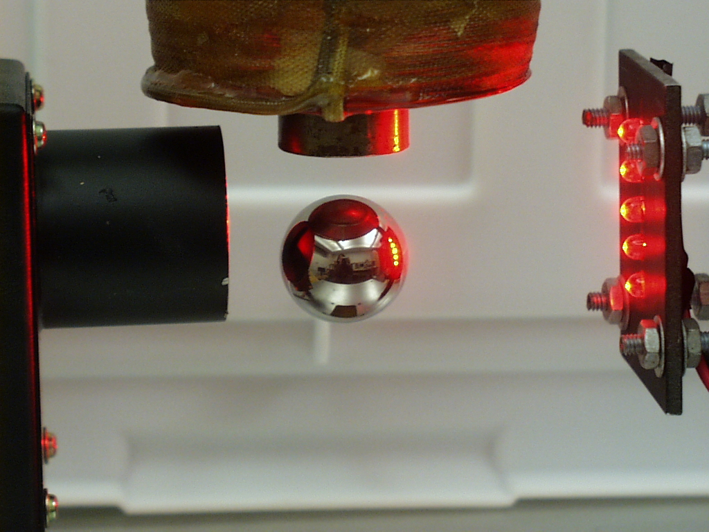
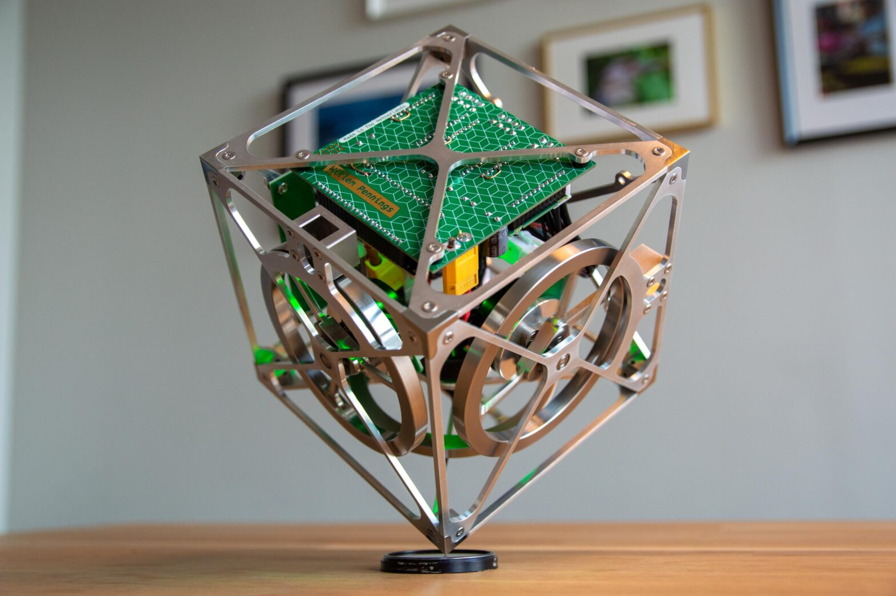

# embedded_control_system

Here are four project ideas that strike the perfect balance: they are mathematically rich enough to justify using Simulink and cybernetic concepts (like state-space control or sensor fusion), yet highly practical to build, test, and flash onto a Microchip MCU using your VS Code / MPLAB toolchain.

1. The Active Suspension Rig (Quarter-Car Model)

Instead of building a whole vehicle, you build a single vertical track with a wheel, a spring, and an electronic actuator (like a strong hobby servo or a voice-coil motor). A distance sensor measures the "chassis" height as a motorized bumpy belt moves underneath it.
• The Cybernetic Challenge: Classic PID struggles here because the system has multiple coupled variables (wheel bounce vs. body comfort). You can implement an LQR (Linear Quadratic Regulator) controller or a State-Space controller to dynamically minimize chassis acceleration while keeping the tire glued to the ground.
• Why it’s great for learning: The physical build is mostly structural (3D printed linear rails or drawer slides). In Simulink, you can model the exact physics (mass, spring rates, damping) and simulate how the controller reacts to a pothole before flashing the code to your Microchip MCU.

2. An Inverted Pendulum on a Cart (The Control Classic)

A small motorized cart runs along a linear rail, balancing a free-swinging stick vertically on top of it. Your microcontroller must read the angle of the stick and the position of the cart, moving the cart back and forth to keep the stick upright.
• The Cybernetic Challenge: This is a non-linear, inherently unstable system. To solve it, you will need to use a Kalman Filter in Simulink to combine data from an IMU (gyroscope/accelerometer) on the stick and an encoder on the cart's motor. You will use pole-placement or LQR to keep it stable.
• Why it’s great for learning: It is the ultimate rite of passage for embedded control engineers. It forces you to deal with hard real-time execution constraints because if your MCU loop drops even a few milliseconds behind, the pendulum crashes.

3. A Magnetic Levitation System (MagLev Bead)

An electromagnet hangs from a frame, pointing downward. A distance sensor (like an infrared or time-of-flight sensor) sits right below it. The goal is to vary the current to the electromagnet so perfectly that a steel bearing floats completely untouched in mid-air.
• The Cybernetic Challenge: Magnetic force follows the inverse-square law, making this highly non-linear. As the bead gets closer, the pull gets exponentially stronger. You will use Simulink to linearize the plant around an equilibrium point, or implement Gain Scheduling (where your control parameters change depending on how far away the bead is).
• Why it’s great for learning: The hardware is incredibly simple—just an electromagnet, a transistor/MOSFET driver, a sensor, and a steel ball. However, the control theory required to keep it from snapping to the magnet or falling to the floor is highly advanced.

4. A Self-Balancing Cubli (The Reaction Wheel Cube)

A small 3D-printed cube houses a motor spinning a heavy metal flywheel. By precisely controlling the speed and braking of that wheel, the cube can jump up, balance precariously on one of its edges or corners, and resist being pushed over.
• The Cybernetic Challenge: This relies heavily on conservation of angular momentum. You will use an IMU to track the cube's tilt angle and feed it into a state-space controller that converts angular error into exact motor torque commands.
• Why it’s great for learning: It looks like magic when it works, making it an incredibly rewarding personal project. It heavily exercises your ability to read sensors via I2C/SPI and output high-speed PWM commands from your Microchip hardware blocks.

<!--
Source - https://stackoverflow.com/q/41604263
Posted by zjffdu, modified by community. See post 'Timeline' for change history
Retrieved 2026-10-20, License - CC BY-SA 4.0
-->

Strategic Tips for a Beginner

1. Start in "Desktop Simulation Only": Do not touch hardware first. Build the mathematical model of your physical system entirely out of standard Simulink blocks (Integrators, Gains, Transfer Functions). Get your controller working flawlessly on your computer screen.
2. Use External Mode: Once the hardware is built, use Simulink's External Mode over a USB cable. This lets you watch live scopes of your sensors in VS Code/MATLAB and tune your controller variables in real-time without constantly reflashing the chip.
